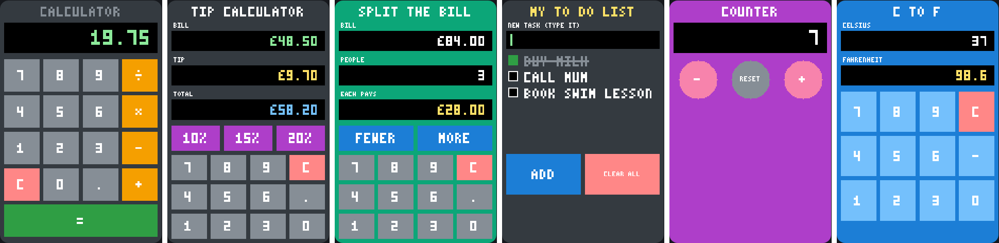

# natural-to-binary

**Can we skip code completely, and go from plain English straight to binary a machine runs?**

This project tries to find out, from first principles. It doesn't use a programming language in the middle: English goes in, and WebAssembly bytes (or raw machine code) come out.

> Status: early research project. The rule-based compilers work and are tested. The trained-AI part does not work yet, and the results below say so honestly.



*Six apps, each written only in English sentences and running as a 3–5 KB WebAssembly binary.*

## Try it

Live demos (GitHub Pages, in the [`docs/`](docs) folder):

| Demo | What it does | Needs |
|---|---|---|
| [Structured English v0.2](docs/structured-english.html) | Six small apps (calculator with decimals, tip calculator, bill splitter, to-do list, counter, °C→°F), each written only in English sentences and compiled to a 3–5 KB binary for a 160×240 “tiny phone” | nothing, runs offline |
| [Structured English v0.1](docs/structured-english-v1.html) | The first version: one whole-number calculator | nothing |
| [Tiny Machine](docs/tiny-machine.html) | Each word becomes its own binary piece; pieces combine into a clickable program | nothing |
| [English to Binary](docs/english-to-binary.html) | Strict English maths → WebAssembly, shown sentence by sentence | nothing |
| [Say It, Compile It](docs/say-it-compile-it.html) | Everyday English → Claude rewrites it into Structured English → compiler → binary | open on claude.ai |
| [Just Say It](docs/just-say-it.html) | Any request; number questions come back as raw bytes, tested and auto-repaired | open on claude.ai |

## How it works

```
everyday English        "a pink calculator that can only add and subtract"
      ↓  AI rewrites (Claude today; a small trained model later)
Structured English      "Buttons, four per row: 7 8 9 + … When I press equals: …"
      ↓  rule compiler (no AI, never guesses)
WebAssembly binary      00 61 73 6d 01 00 00 00 …
      ↓  browser translates for the chip
switches on the chip    on / off
```

The key design decision: **the AI only rewrites English into stricter English.** The step that writes bytes is a rule-based compiler, so a byte is never guessed. That splits the problem in two:

1. **Understanding what someone meant**, which needs an AI.
2. **Writing every byte correctly**, which needs rules and tests.

## What's in this repo

```
compilers/
  structured-english-v2/  strict English → 160×240 "tiny phone" apps: words, decimals, money, lists, typing, round buttons
  structured-english/   v0.1: strict English → 128×128 machine binary (calculator milestone)
  tiny-machine/         ~50-word vocabulary → 32×32 clickable programs
  english-to-binary/    English-looking maths language → WebAssembly
experiments/
  01-direct-wasm-benchmark/       can a model write raw WebAssembly bytes directly?
  02-hand-written-native-binary/  a 178-byte Linux program written byte by byte
  03-tiny-model-from-scratch/     training a small model to map English → bytes
docs/                   the live demo pages
```

## Results so far

| Experiment | Result |
|---|---|
| Raw WebAssembly written directly from 10 English task descriptions | 10 / 10 correct first try (same as via Python). Small, integer-only tasks. |
| Hand-written native Linux binary (178 bytes, no compiler) | Runs and prints its message |
| Structured English v0.1 → calculator binary | 13 / 13 automated checks pass (+ − × ÷, negatives, divide by zero, clear) |
| Structured English v0.2 → six apps | 28 / 28 checks pass, by simulated presses and typing: 12.5 + 7.25 = 19.75, £48.50 at 20% → £9.70 tip, £84 ÷ 3 = £28.00, to-do add/tick/clear, 37 °C → 98.6 °F |
| Tiny Machine word-piece compiler | 16 / 16 checks pass, including simulated clicks |
| Small transformer trained **from scratch** on 16,428 verified English → binary pairs | 100% on training examples, **~5%** on new wording, **~5%** on new numbers. It memorised; it did not understand. |

### What the failure taught me

The binary was never the hard part. The model produced valid bytes for everything it had seen. It failed because it started knowing **no English**, so it couldn't tell that "odd or not" and "is it odd" mean the same thing. That's why the next step is to start from a small open model that already knows English, and give it the easier job of rewriting into Structured English.

## Example: a whole app in English

This is the complete tip calculator. These sentences are compiled straight to a 3,970-byte WebAssembly binary:

```
The screen is charcoal.
Write "TIP CALCULATOR" at the top in white.
Remember a number called bill, and a number called rate starting at 15.
A display, labelled "BILL", shows bill as money in lime.
A display, labelled "TIP", shows rate percent of bill as money in yellow.
A display, labelled "TOTAL", shows bill plus rate percent of bill as money in sky.
Buttons, three per row: "10%" "15%" "20%".
Buttons, four per row: 7 8 9 C 4 5 6 . 1 2 3 0.
The word buttons are purple.

When I press a digit:
  Type the digit into bill.
When I press .:
  Type a point into bill.
When I press C:
  Clear bill.
When I press "10%":
  Rate becomes 10.
When I press "15%":
  Rate becomes 15.
When I press "20%":
  Rate becomes 20.
```

## Run the tests

Needs Node 18+.

```bash
npm test
```

## Roadmap

- [x] Structured English v0.1 (calculator)
- [x] Everyday English → Structured English using Claude, with automatic repair
- [x] v0.2: letters, decimals and money, several displays, round buttons, a text box with keyboard typing, lists
- [ ] Build a dataset of everyday English → Structured English pairs
- [ ] Fine-tune a small open model for that rewriting step, and measure it against the 5% baseline
- [ ] Output native machine code directly (e.g. a Raspberry Pi calculator)

## Related work

- Armengol-Estapé & O'Boyle, *Learning C to x86 Translation: An Experiment in Neural Compilation* (University of Edinburgh, 2021)
- Cummins et al., *Meta Large Language Model Compiler* (Meta, 2024)
- Grace Hopper's FLOW-MATIC (1955–59): the first English-like programming language, and the ancestor of this idea

## Credits

Built by Muhammad Abu Sayeed, working with Claude (Anthropic) as a pair-programmer and tutor.

MIT licence.
